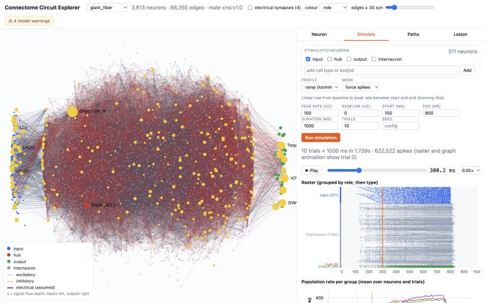
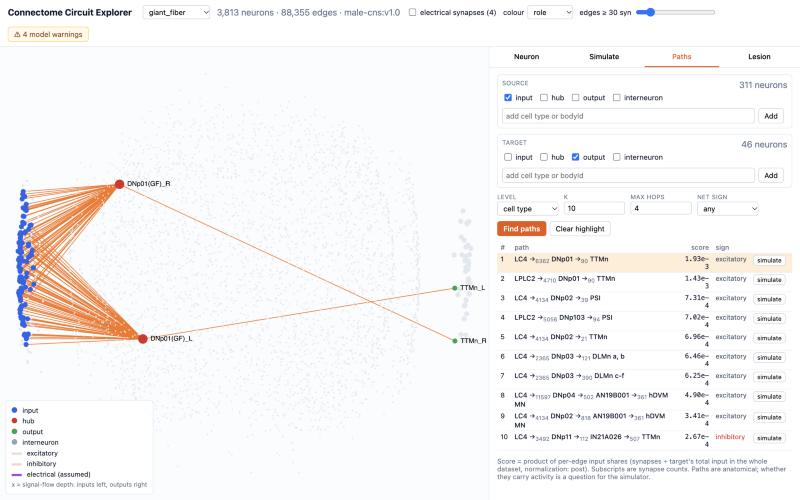
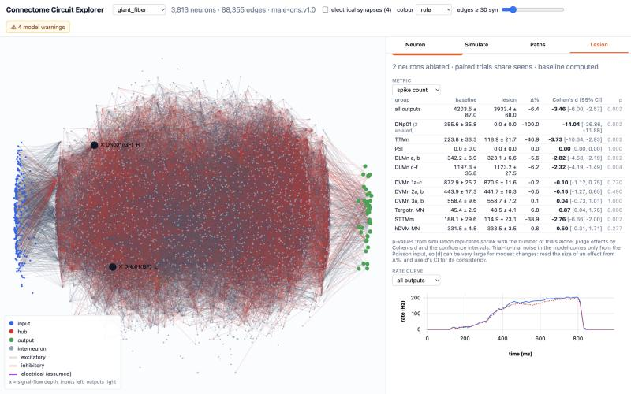

# Connectome Circuit Explorer

An interactive web app on the **MaleCNS *Drosophila* connectome** (`male-cns:v1.0`, via neuPrint) that combines three tools on one configurable sub-circuit:

1. **LIF circuit simulator**: leaky integrate-and-fire network on the real synaptic wiring; raster, rate curves, and a playback that makes spiking neurons glow on the graph.
2. **Signal-path finder**: the k strongest pathways from a source set to a target set (exact A* search, hop and sign limits).
3. **Virtual lesions**: ablate neurons or cell types; compare against a cached baseline with paired seeds; screen every cell type and rank its effect.

The first circuit is the **Giant Fiber escape circuit**: looming-sensitive LC4/LPLC2 → Giant Fiber (DNp01) → jump/flight motor neurons (TTMn, PSI, DLMn, …). A second circuit, **feeding** (taste neurons → proboscis motor neurons), shows that a new circuit is a config change only.

> **Simulation outputs are not biological ground truth.** Every modelling choice (signs, parameters, thresholds, electrical synapses) is listed in [docs/ASSUMPTIONS.md](docs/ASSUMPTIONS.md), with a sensitivity analysis of what the conclusions depend on.

| Simulate (t = 300 ms, active neurons glow) | Strongest paths LC → motor | GF lesion vs baseline |
|---|---|---|
|  |  |  |

## Requirements

- macOS or Linux, Python ≥ 3.12 (developed on 3.14; every dependency ships binary wheels), Node ≥ 20, `make`
- A neuPrint account, only for fetching data. The app itself runs offline.

## Setup

```bash
make install
```

This creates `.venv` with Python 3.14 (override with `make install PYTHON=python3.12`), installs the backend with its dev and fetch extras, and runs `npm install` in `frontend/`.

### neuPrint token (only needed to fetch data)

1. Log in at https://neuprint.janelia.org → account menu → **Account** → copy the **Auth Token**.
2. Store it **only** as an environment variable. This command asks for it without echoing it to the screen:

```bash
read -s 'T?Paste your neuPrint token: ' && echo "export NEUPRINT_APPLICATION_CREDENTIALS=\"$T\"" >> ~/.zshrc && unset T && source ~/.zshrc
```

`neuprint-python` reads `NEUPRINT_APPLICATION_CREDENTIALS` automatically. Never put the token in code, notebooks or config files; if one ever leaks, regenerate it on the Account page. `.env` files are git-ignored as an extra safety net.

## Fetch data (one-time per circuit)

```bash
make fetch CONFIG=giant_fiber        # ~35 s fetch + ~20 s layout
make fetch CONFIG=giant_fiber_lite   # optional dev-only variant
make fetch CONFIG=feeding            # optional second circuit
```

This writes `data/<name>/{neurons,edges,layout}.parquet` and `manifest.json` (dataset, server version, date, thresholds, counts). `scripts/fetch_circuit.py` is the only code that talks to neuPrint; the app never calls it at runtime. Re-run the same command to refetch.

## Run

```bash
make dev
```

This starts the FastAPI backend on http://127.0.0.1:8000 (interactive API docs at `/docs`) and the Vite frontend on **http://localhost:5173**. Ctrl+C stops both.

## Tests, lint, format

```bash
make test     # 80 backend tests: analytic LIF rate, brute-force-verified path search, stats, API, ...
make lint     # ruff + oxlint + prettier check + tsc --noEmit (strict)
make format   # ruff format + prettier
make sanity   # re-run the Phase 5 science checks (~2 min) -> docs/SANITY_RESULTS.md
```

## Walkthrough

1. **Pick a circuit** in the header. Nodes are coloured by role (blue input, red hub, green output, grey interneuron); the x-axis follows signal-flow depth, so inputs sit on the left and motor neurons on the right. The slider hides weak edges in the drawing only; the simulation always uses every edge. Labels appear as you zoom in.
2. **Simulate.** The default is a looming-like linear ramp (0 → 100 Hz) on all input neurons. Click *Run simulation*, then *Play* (or click the raster) to watch spikes spread across the graph. Below: the raster grouped by role/type, per-group rate curves, and the most active types.
3. **Paths.** Choose a source and a target (types, roles or bodyIds), then *Find paths*. Score = product of the per-edge shares of each target's total input. Click a row to highlight the path; *simulate* pre-fills the stimulus with the path's first node and plots its types.
4. **Lesion.** Add `DNp01` (or tick *click graph nodes to ablate*), then *Run baseline vs lesion*. The table reports the mean ± SD per output group, Δ%, and Cohen's d with a bootstrap 95% CI; the p-value is shown greyed out, as secondary. The rate-curve overlay shows the baseline solid and the lesion dashed.
5. **Lesion screen.** Removes each cell type in turn (all 1,462 take ~5 min) and ranks the effect on a measured group. Click a bar to highlight that type.
6. **Electrical synapses** (header toggle) adds the literature-based GF→TTMn/PSI gap junctions, which EM cannot see. This is a labelled assumption, not data; see ASSUMPTIONS §3.
7. **⚠ model warnings** lists sign fallbacks and other caveats for the loaded circuit.

## Add a new circuit

Create `configs/<name>.yaml`; see [configs/feeding.yaml](configs/feeding.yaml) for a minimal example that inherits everything except the seeds:

```yaml
extends: giant_fiber.yaml
name: my_circuit
selection:
  inputs: [TypeA, TypeB]   # discover exact names in neuPrint first
  hubs: []
  outputs: [TypeC]
extra_edges: {enabled: false, edges: []}
```

Then run `make fetch CONFIG=my_circuit` and pick it in the app. No code changes are needed. Selection keeps the seeds plus every neuron that is ≤ `hops_down` from the inputs **and** ≤ `hops_up` from the outputs, on edges ≥ `min_weight` synapses, and raises the threshold automatically if `max_neurons` is exceeded.

## Project layout

```
configs/                 circuit definitions (YAML, with `extends`)
scripts/                 fetch_circuit.py (only neuPrint caller), compute_layout.py, sanity_checks.py, dev.sh
backend/connectome_app/  config, data (sparse W), signs, lif, stimulus, analysis, paths, stats, lesion, layout, service, api
backend/tests/           pytest suite (synthetic fixture + cached-data tests)
frontend/src/            React + TS: GraphView (sigma.js), panels/, charts/ (uPlot, canvas raster)
docs/                    ASSUMPTIONS.md, SANITY_RESULTS.md, NOTES.md (learning notes, Turkish)
```

## Key results (Phase 5; details in [docs/ASSUMPTIONS.md](docs/ASSUMPTIONS.md) §6)

- Holds: no input → silence; a strong looming-like ramp → GF → TTMn (and DLMn) fire; PSI fires only with the electrical GF→PSI edges.
- Fails: the model GF responds to weak input and saturates at 200–400 Hz. The point-neuron LIF with one global threshold and w_syn cannot reproduce GF's selectivity and sparseness.
- GF lesion: TTMn output always decreases (the direction is robust), but the size of the decrease ranges from −0.4 % to −100 %. It depends mostly on whether glutamate is treated as inhibitory, then on w_syn, the electrical edges and the size of the sub-circuit.
